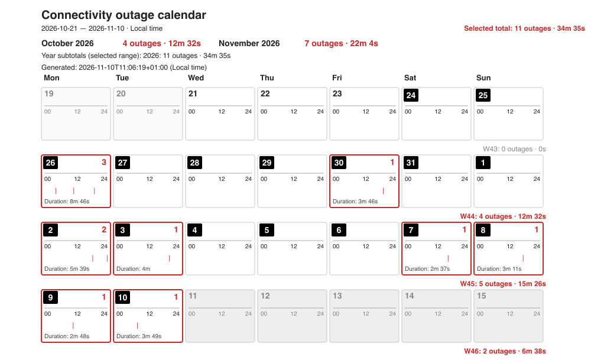

# Link Watch

[](https://www.python.org/downloads/)
[](https://github.com/deeplook/linkwatch/blob/main/LICENSE)
[](https://github.com/deeplook/linkwatch/issues)
[](https://github.com/deeplook/linkwatch/stargazers)

Link Watch is a small command-line monitor for internet reachability. Every five
seconds by default, it tries Google, Apple, then Microsoft, stopping at the first
successful response. If all three checks fail, it records the connection as
offline. It logs connectivity transitions to CSV and can render the history as
an SVG timeline or outage calendar.

## Example calendar



*Three-week example (October 21–November 10, 2026). The recorded log begins
October 24, so October 21–23 have no coverage.*

- **Platforms:** requires Python 3.12 or newer. Background-service management
  supports macOS (LaunchAgent) and Linux with `systemd --user`. Windows is not
  currently tested or officially supported, and has no built-in service backend.
- **Network and privacy:** probes contact Google, Apple, and Microsoft. On a
  detected reconnection, Link Watch also asks ipify (then icanhazip as fallback)
  for the public IPv4/IPv6 addresses and saves any returned addresses in the
  local CSV log. Those lookup services can observe the public address. See
  [monitor behavior and logged data](#monitor-options) for details.
- **License:** [MIT](LICENSE)

## Install

This README documents source installation; it does not currently provide a
package-index install command. Install [uv](https://docs.astral.sh/uv/) and Python
3.12 or newer, then clone the project and install it as a user-level command-line
tool:

```sh
git clone https://github.com/deeplook/linkwatch.git
cd linkwatch
uv tool install .
```

This installs the checked-out version as a regular tool, not as an editable
development copy. Ensure uv's executable directory is on your `PATH`; then
`linkwatch` can be run from any directory. To use a downloaded source archive
instead, extract it, open a terminal in the extracted project directory, and run
`uv tool install .`.

## Quick start

Start monitoring:

```sh
linkwatch monitor
```

Stop it with Ctrl-C. The event log is written to
`~/.linkwatch/connectivity.csv` by default. To poll every half-second instead of
every five seconds:

```sh
linkwatch monitor --period 0.5
```

Render the recorded history with `linkwatch chart` or `linkwatch calendar`; see
[Charts](#charts). Running `linkwatch` without a command displays help. Use
`linkwatch --help` or `linkwatch <command> --help` for command details.

## Monitor options

- `--interval` / `--period SECONDS`: seconds between probe cycles (default `5`); accepts fractional values such as `0.5`.
- `--timeout SECONDS`: per-endpoint request timeout in seconds (default `2`)
- `--log PATH`: CSV log path (default `~/.linkwatch/connectivity.csv`; its parent directory is created automatically)

Stop with Ctrl-C; the per-user LaunchAgent and systemd services also request a
clean stop with SIGTERM. The CSV columns are
`timestamp_utc,event,endpoint,public_ipv4,public_ipv6`. Legacy CSV files are
migrated atomically on the next event write; historical IP fields remain blank
because they cannot be reconstructed.

Connectivity rows (`connected` / `disconnected`) are written only when
reachability changes. Each monitor process adds `monitor_started` at startup and
`monitor_stopped` when it exits gracefully; lifecycle rows have an empty endpoint.
A crash, unhandled failure, or forced kill cannot reliably write a stop row, so
an unmatched start may indicate that monitoring ended unexpectedly. On a later
restart, the next start row identifies the new run but cannot establish the exact
failure time. A failed first probe is logged as `disconnected`; startup while
online still does not create a synthetic connectivity event. For a `connected`
event, `endpoint` contains only the provider label `Google`, `Apple`, or
`Microsoft` that first responded. Link Watch also records `public_ipv4` and
`public_ipv6` on that row, querying ipify first and icanhazip only as a fallback
for each family. If an address family is unavailable or both lookups fail, its
field is blank. These lookups run only on a detected reconnection, not on every
poll; the external lookup services can observe the public address. For a
`disconnected` event the endpoint and IP fields are empty. The reachability probe
regards HTTP status 2xx or 3xx as success; it does not validate each provider's
response body.

These checks indicate reachability to at least one of the listed services, not
an absolute guarantee that every internet destination is reachable. Captive
portals, DNS/network filtering, or outages affecting all endpoints can still
cause misleading results.

## Background service

The platform-neutral `service` subcommands select the native per-user service
manager automatically: LaunchAgent on macOS and `systemd --user` on Linux. This
is optional; you can run `linkwatch monitor` directly instead. Windows is not
currently tested or officially supported, and has no built-in service backend.

```sh
linkwatch service install --period 5
linkwatch service status
linkwatch service stop
linkwatch service start
linkwatch service uninstall
```

Linux requires a working systemd user manager (`systemctl --user`). Its unit is
installed at `~/.config/systemd/user/linkwatch.service`; service output is sent
to the journal and can be inspected with
`journalctl --user -u linkwatch.service`. The service starts with the user's
systemd session. To keep it running after logout, enable lingering for the user
if supported by the distribution (for example, `loginctl enable-linger "$USER"`).
Distributions without systemd user services are not currently supported by the
built-in Linux service commands; running the monitor directly may still work.

On macOS, the platform-neutral commands manage the same per-user LaunchAgent
described below. The explicit `linkwatch launchd` command group remains
available for macOS-specific operation.

### macOS LaunchAgent

After installing Link Watch using the [instructions above](#install), install and
check the per-user LaunchAgent:

```bash
linkwatch launchd install --period 5
linkwatch launchd status
```

`install` writes `~/Library/LaunchAgents/com.linkwatch.agent.plist` and starts monitoring immediately. It also configures launchd to start the monitor at login and keep it running. The CSV defaults to `~/.linkwatch/connectivity.csv`; diagnostic output goes to `~/.linkwatch/launchd.stdout.log` and `~/.linkwatch/launchd.stderr.log`.

Manage it later with:

```bash
linkwatch launchd stop       # stop and disable auto-start
linkwatch launchd start      # re-enable and start/restart
linkwatch launchd status
linkwatch launchd uninstall  # remove the agent; preserve CSV and logs
```

You can choose a different period or CSV destination at install time, and those settings are stored in the LaunchAgent plist:

```bash
linkwatch launchd install --period 0.5 --log ~/Documents/linkwatch.csv
```

These commands target only the current user's GUI launchd domain; they do not use `sudo` or install a system-wide daemon. `stop` leaves the plist in place but disables it across logins; `uninstall` removes the plist and clears that disabled state. The CSV and diagnostic logs are retained.

## Charts

Generate a dependency-free SVG timeline from the recorded transitions:

```sh
linkwatch chart --output connectivity.svg
```

`chart` reads `~/.linkwatch/connectivity.csv` by default and writes
`linkwatch.svg` in the current directory. Use `--log PATH` to chart a
different CSV file and `--output PATH` to choose where the SVG is saved. For
example:

```sh
linkwatch chart --log ~/Documents/linkwatch.csv --output week.svg
```

By default the timeline ends at the current time (or at the latest event if it
is later). To make the same event log render reproducibly, provide a fixed,
timezone-aware ISO 8601 endpoint with `--end-time`:

```sh
linkwatch chart --log ~/Documents/linkwatch.csv \\
  --end-time 2026-11-10T08:00:00+01:00 --output week.svg
```

The timestamp is normalized to UTC for display. The library API also exposes
`read_chart_events()` for validated, UTC-sorted event data and `render_chart()`
for rendering supplied events without reading a file. `generate_chart()` remains
the convenience function that combines those steps.

Green indicates online and red indicates offline. When lifecycle events are
present, blue triangle/vertical markers show monitor starts and purple square/
vertical markers show graceful stops; light gray means monitoring was stopped
or the connectivity state is not known (for example, an online startup before
the first state transition). Connectivity color does not carry through a stopped
period or across a monitor restart. Older CSV logs without lifecycle rows retain
their original continuous transition interpretation. The chart spans from the
first recorded event to now (or the last event if it is in the future). SVG is
written using only the Python standard library and can be opened in a browser or
image viewer. Both chart types use an explicit white background.

Generate the calendar-style outage chart:

```sh
linkwatch calendar --period month --output outages-month.svg
# Or select an inclusive date range and render in UTC instead of local time:
linkwatch calendar --from 2026-01-01 --to 2026-01-31 --timezone UTC --output january.svg
```

The calendar uses local time by default; choose `--timezone UTC` or an IANA zone
such as `Europe/Berlin` to change the display timezone. Day numbers with a white
number on a black badge mark dates covered by recorded Link Watch monitoring
sessions (including days with no outages); dates without recorded coverage keep
a plain number. An unmatched `monitor_started` session is considered covered only
through the last recorded event, so the chart does not assume monitoring continued
beyond the available log evidence. Days containing any recorded event are also marked
as having data. Day cells show a 24-hour track with red outage stripes; positive daily outage-start counts appear in red
with a red cell border, while zero counts are omitted. Weeks are rendered as full
Monday-to-Sunday rows. Calendar-period views show only dates in that period (so
an October view does not add November dates); explicit partial date ranges show
adjacent dates as light context cells. Future dates are shaded gray, and ongoing
outage stripes stop at the chart-generation time so unobserved future time is not presented as fact.
The chart-generation timestamp is shown above the grid in the selected timezone.
Cross-midnight outages continue into the next day but count only on the date they
started. Each day with outage overlap shows that day's total duration (including
continuation time from a cross-midnight outage); outage-start counts remain on the
start date. Weekly, selected-range, monthly, and annual summaries show both counts
and durations above the grid. `--from` and `--to` are inclusive and must be
supplied together; without them, the chart spans the
available log dates (and through today for a currently open outage). Lifecycle
stops end the observed interval; unmonitored time is not inferred to be offline.
`--period` accepts `day`, `week`, `month`, `3-months`, or `year`, aligned to the
calendar period containing the latest log date; `--period` cannot be combined
with `--from`/`--to`.

For Python callers and tests, `read_calendar_events()` returns validated,
UTC-sorted event data, and `render_calendar_chart()` renders an in-memory event
sequence without a CSV input file. Pass a fixed timezone-aware `generated_at`
timestamp for reproducible output. `generate_calendar_chart()` remains the
convenience function that reads a CSV and renders the calendar.

## Development

For development, run commands inside the project environment with `uv run`:

```sh
uv run linkwatch monitor
uv run linkwatch chart --output connectivity.svg
```

The Makefile provides `make install`, `make test`, `make build`,
and `make install-tool`. Use `make help` to list targets. `make build` writes a
wheel and source distribution into `dist/`; `make install-tool` installs the
local package globally as an editable uv tool.

Run the offline pytest suite with:

```sh
uv run pytest
```

That command runs all mocked backend tests on any host. `make test` first checks
`uname` and runs the core/dispatch tests plus the native service backend tests:
LaunchAgent on macOS or systemd user-service tests on Linux. You can verify the
other selection locally with `make TEST_PLATFORM=Linux test` or
`make TEST_PLATFORM=Darwin test`; these tests mock both managers and do not load
or modify a real service.

## References

- [Internet Connection Monitor](https://internetmon.org/) is a Chrome extension that tracks connectivity, latency, outage history, and exports event logs as CSV or PDF.
- [Net Uptime Monitor](https://netuptimemonitor.com/) is a Windows desktop app that checks multiple public servers and logs internet connection failures with their times and durations.
- [PingPlotter](https://www.pingplotter.com/) continuously graphs network paths and performance metrics such as latency and packet loss to help diagnose intermittent problems.
- [SmokePing](https://oss.oetiker.ch/smokeping/) is an open-source latency and packet-loss monitor that stores long-term measurements and renders graphs.
- [Uptime Kuma](https://uptime.kuma.pet/) is a self-hosted monitoring dashboard for checking the availability of websites, services, and network targets.
